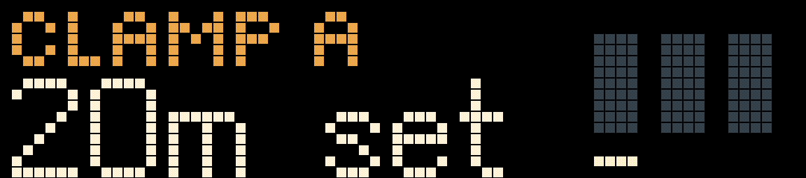
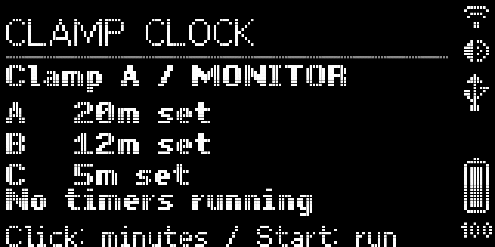

# Clamp Clock

Run three independent glue-clamp timers and find which assembly is ready to release.

Three glue-ups rarely go into clamps together. Give each one its own clock and read all three from the back instead of restarting a shared timer for the latest piece.

The three columns are clamps A, B and C. A running timer fills in amber and turns green when it is ready to release. The underline follows the clamp selected with the wheel.

## Screen transitions

Move between two clamp timers. Each remaining time belongs to the selected assembly.



<details>

<summary>Watch the rear display</summary>



</details>

## Set the first assembly’s timer

1. Label the work positions A, B and C. Turn to the matching clamp and click to edit its duration. The wheel changes the value one minute at a time.
2. Click to leave the editor. Press **Start** when the work goes into that clamp.
3. The recording changes A from 20 to 21 minutes. Its front switches from a set duration to a running countdown.


## Run a second clamp independently

1. While A is running, turn to B and press **Start** to begin B’s configured interval. Turn back to A to see that its own deadline still applies.
2. The rear lists all three clocks and the earliest due clamp. **RELEASE** means the interval you entered has elapsed.
3. Press **Start** on an elapsed timer to acknowledge it. Hold **Start** on the selected clamp if you need to cancel that timer.


## Example from the emulator

If A starts a 21-minute interval at 10:00 and B starts 12 minutes at 10:03, B is due at 10:15 and A at 10:21. The app stores absolute deadlines so reopening it preserves those times. Use the interval appropriate to the material you are clamping.

## Run in the emulator

Open BUSY Bar Emulator. From this repository, run:

```sh
~/.busy-emulator/bin/busy-emulator dev --once
```

Press **Back** to exit.

The GIFs are excerpts from the emulator recording. Each LED occupies a 16 × 16 cell with a black border. The end frames pause for reading.

[Full recording](media/controls.mp4) · [Rear display](screenshots/back-1.png) · [Firmware test](EMULATOR-QA.md) · [MIT license](LICENSE)
